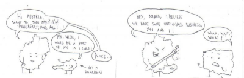

Am găsit pe internet o istorisire foarte tare despre al doilea război mondial în imagini și text – amuzant, real, ironic 🙂

Germania s-a aliat cu Austria, mă rog, sau a înglobat Austria și a luat o rangă în mână ca să o căsăpească pe Polonia, iar, pentru că tot așa a început și primul război mondial. Unele lucruri nu se schimbă :>

Desigur, Germania a bătut Polonia, dar a atras atenți Marii Britanii și a Franței.

Care s-au cam enervat că Germania și-a permis să intre peste polonezi, deși nemților li s-a părut o chestie perfect ok. Cele două țări fac aici pe mami și tati care s-au supărat pe copiluț că a făcut o prostie. A, da și îi declară război Germaniei(observați că Austria a ieșit din subiect – anexată)

(aici se bat toți)

Germania invadează Norvegia și Danemarca, fără să îi pese de amenințările Franței și Marii Britanii

Și apoi, împreună cu Italia, o iau la bâte pe Franța, pe care o și căsăpesc 🙂

Germania devine arogantă și, eh, decide să dea cu ranga în URSS.

Care se enervează și își arată mușchii, ca să o sperie pe Germania.

Între timp, Marea Britanie a mers la SUA să se plângă de comportamentul Germaniei.

Însă americanii aveau alte probleme de rezolvat – Japonia umbla la insulițele ei din Pacific.

Și așa a intrat SUA în război.

Pe frontul din Europa, Germania își face curaj împreună cu Italia să atace URSS, care nu reușise să o bată pe Finlanda – minusculă în comparație cu ea.

Lucrurile încep să se precipite și în Pacific….

și pe frontul rusesc se fac primele cuțităreli, iar, în Africa, Germania ia bătaie 😀 – prima înfrângere de la pornirea războiului…

Dar în Rusia a venit iarna, ceea ce pentru nemți a însemnat…înghețul avansării în interior, la Stalingrad.

Italia a fost făcută praf de SUA, care a eliberat între timp și Franța, debarcând în Normandia.

Germania a fost gonită și din Polonia și se apropia deja finalul…

Între timp, americanii au aruncat și bomba în Japonia- situație încheiată acolo :-j

Dar SUA și Rusia mai aveau niște chestii de împărțit – Războiul Rece.

Fin!?

Sper că v-a plăcut istoria Războiului în câteva imagini – am găsit-o aici, unde mai sunt și alte chestii tari 🙂
