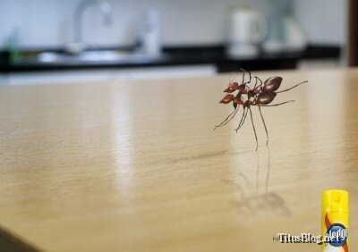

Azi am frunzărit puțin adsoftheworld.com și am găsit imaginea de mai sus, care face cât un punchline mișto. Oamenii ăștia nu au avut nevoie de cuvinte prea multe ca să ne zică ce face produsul lor. Ne-au arătat și încă foarte memorabil.

”Așa de fine suprafețele și lucioase, că ajung patinoar pentru furnici.”

Cele 2 insecte apar dansând. Pe ce melodie oare?
