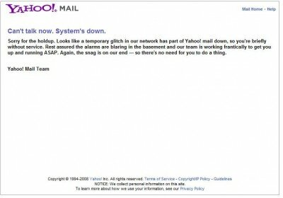

Azi dimineață mi-a trimis o prietenă un screenshot cu un mesaj foarte simpatic de la Yahoo!. Serviciul căzuse și ei au anunțat-o printr-un mesaj mai mult decât colocvial 🙂

Are un stil foarte ”may-day may-day” – Anunțul vine ca urmare a căderii Yahoo! Mail pentru câteva minute. Mi-a plăcut cum s-au scuzat și au asigurat-o că lucrează frenetic la remedierea problemei și că nu are niciun motiv să se alarmeze, pentru că problema e de la ei.

Le sună alarmele în subsolurile din datacenter 🙂

Foarte simpatic, în comparație cu colegu GMail, care dă o eroare 500 și atât!
