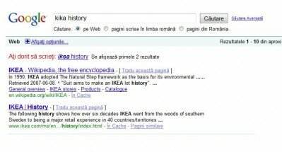

Am primit zilele trecute de la o prietenă, un pont despre cum Google o comite puțin, când vine vorba de Kika, concurentul celor de la IKEA. Cel mai mișto rezultat îl obțineți atunci când căutați istoria Kika și Google vă sugerează să vă orientați spre linkurile IKEA.

Imaginea de mai jos nu e singura de tipul ăsta, ci chiar și o căutare pe cuvântul ”kika” întoarce la sugestii ”ikea”. Ce poți să mai faci în cazul ăsta?

Ce fel de SEO ar avea nevoie Kika să scape de asocierea asta. Totul li se trage de la asemănarea de nume.
