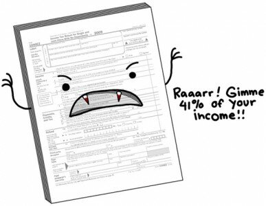

Da, se apropie acel moment din viața oricărui mic antreprenor/angajat agitat, în care trebuie să declare tot ce a făcut în anul precedent, ca să îl taxeze statul cum trebuie. Dacă la noi încă nu e așa de tragic, poate că vom ajunge să ne identificăm cu poza de mai jos, dacă ministerul Gheorghe și Bitman(a se citi Vlădescu) va trimite în parlament legea de impozitare a dreptului de autor cu peste 30%.

În fine, m-am amuzat copios când am primit pe Feed Reader comicul de la Natalie Dee, ca în fiecare dimineață.

Fără alte introduceri, vă prezint forumlarul fiscal de tip vampir:

p.s. parcă mi-e și groază de ziua aia când o să trec pe la administrația financiară a sectorului 3 și o să mă plimb cu hârtiile în brațe, de la ghișeu la ghișeu.

my2c
