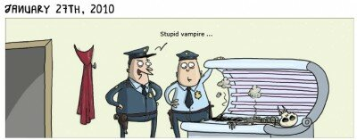

 O remarcă strălucită, aproape la fel de puternică în comparație cu unda solarului.    
de pe wulffmorgenthaler.com 

Vampiru care a confundat solarul cu sicriul. 🙂

și reversul medalie

 Americani cu aparate foto, la țară.    
de pe fffound.com 

– Îi dăm foc?  
– Bine, da tu îl refaci.  
– Da, da, taci și zâmbește….click!

O zi zâmbăreață vă doresc 🙂
