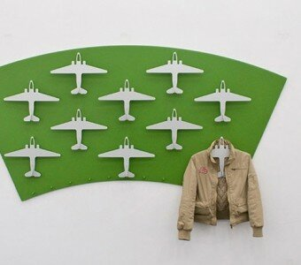

Acum o lună, când am descoperit pachetul de ceai, am devenit dependent de imagini – surse de inspirație. Una din sursele astea îmi livrează în fiecare zi multe imagini cu diferite stiluri de packaging/idei inovative de design interior(așa, cam ca ăsta de mai sus). Airplane Clothes Hangar(totuși e hanger, ca să nu atentez la limba engleză) – a ajuns la mine din tumblr în tumblr.

Mi-aș pune așa ceva la intrare, dar cred că se supără fetele, că e mare, verde și nu prea ergonomic 🙂
