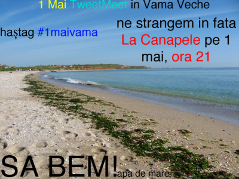

De cu seară îmi fac și eu datoria și promovez #1maivama TweetMeet, la ora 21:00, în față La Canapele.

Cum se ajunge la canapele(dacă nu știai 😀 ):

p.s. dacă ai ochelari 3D poți să vezi vama ca și cum ai fi acolo.

Până acum vin:

@necenzurat  
@saltwaterC  
@titus_k  
@vulupe  
@mihneawalker  
@tomytza89  
@OanaBoanca  
@claudiubadita  
@alexcirstea  
@vladgidea – ăsta e bogat, ne da de baut la tăți 🙂  
@mihailp  
@oanabratila  
@astamicu  
@daniela_savuica  
@petre_fluerasu

Inițiativa a pornit de la necenzurat.

Eu extind un pic invitația și în afara Twitter-ului și întreb: cine o să mai fie în Vamă de 1 Mai?

_*preconizez o golire a capitalei 🙂_
