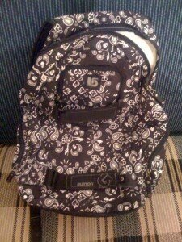

Așa am ajuns să îmi car eu aparatul vital – DELL 1555 Studio, cu rezoluția lui de 1920×1080, split screen și alte cele. Dar nu despre el e vorba aici, ci despre recipientul de care am zis și în titlu.

**Burton Emphasis Backpack** e numele lui complet și a fost construit special pentru munte, ca să îți poți lua cu tine laptop-ul pe pârtie(nu că mi-aș da seama cine naiba ar vrea să facă așa ceva).

Avantajul lui cel mai mare e că are o zonă de protecție în partea de sus, lângă fermoar, deci nu mai tremur de frică în momentele în care mă prinde ploaia pe bicicletă, atunci când mă întorc de la birou.

Mai are el niște buzunare, mici, cam nepractice, dar în care poți să pui mărunțișuri – bomboane, țigări, brichete, cărți de vizită, oricum, chestii mici.

În compartimentul de laptop, deși scrie clar **12 inch** pe el, am reușit să acomodez cu succes monstrul meu de laptop. E la limită, ce-i drept, deci mi-e un pic incomod când merg repede, pentru că mi se bate de spate, dacă baretele sunt prea lăsate.

Nu-l recomand decât pentru felul în care arată – check it out în poză 🙂

p.s. articolul ăsta participă la concursul ”Tu în ce îți cari laptopul?”, unde pot să câștig un Rucsac Crumpler Dark Side Negru Mat 004 🙂 Și să facem un pic de linking pentru genți de laptop, așa, în încheiere.
