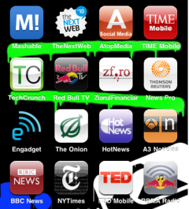

De obicei am grijă de lucrurile mele, însă cu iPhone-ul am reușit de câteva ori să îmi pierd ba aplicații, ba filmări, ba poze, ba contacte, încât am început să cred că e nevoie de câteva sisteme de redundanță.

Unul dintre ele este să scriu undeva despre aplicațiile superutile pe care le-am dezgropat din Apple Store(**pe gratis**).

Nu vreau să vorbesc despre aplicațiile pe care le descarc deja din reflex ( Twitter, Facebook, Foursquare și alte câteva), ci despre aplicațiile de știri.

Una din marile plusuri ale iPhone-ului e că stai conectat tot timpul la informații. Cei care mă cunosc știu că sunt avid de informații, că trebuie să fiu mereu la curent cu tot ce se întâmplă. De aceea mi-am ales 16 aplicații, pe care le țin în ecranul 2, și pe care le accesez zilnic, ca să citesc ce e nou prin lume, prin social media și în sportul extrem.

**Social media:**

Mashable.com – cea mai bună resursă de știri din social media, de aici mă inspir, aflu idei noi, citesc ultimele dezbateri și controverse în privacy policyuri și alte schimbări tehnice, știri despre Twitter, Facebook, HTC, iPhone ****

The Next Web – a social media second opinion, atunci când mai vreau să extind ceea ce am citit pe mashable, TheNextWeb e o resursă destul de bună. Au filială și la noi 🙂

Alltop – Social Media – aplicatia pentru iPhone a celebrului portal al lui Guy Kawasaki, cu cele mai noi articole cu si despre social media.

**Știri:**

Internaționale – > Time Mobile , BBC News, New York Times, Thomson Reuters

Românești – > HotNews, Ziarul Financiar

**Gadgets:**

Engadget – cel mai bun website de gadgeturi din punctul meu de vedere 🙂

Techcrunch – un mashup de gadgeturi, social media, tehnologie, perfect pentru curioși.

**Sport extrem:**

RedBull Tv – o aplicație prin care poți să vezi clipurile filmate de cei din echipa RedBull, pentru diverse sporturi. E foarte tare, doar că trebuie să folosești WiFi, dacă ai plan de date limitat(ca mine)

TED Talks pe iPhone – împărțit foarte frumos pe categorii, dintre care recomand Media with meaning și Inovation. E mai tare ca un audiobook 😀

Cu ocazia asta, mă apuc de un obicei – un TED Talk pe seară, sper să mă țin de el, dacă tot l-am scris aici.

Ți-a plăcut lista de aplicații? Dă-o mai departe. Știi o aplicație mișto? Lasă-mi un comentariu.

p.s. lista nu era completă dacă nu puneam și o aplicație inutilă dar amuzantă – Carl(vorbește ceea ce îi zici, se gâdilă, îl poți ciupi sau lovi :)) )
