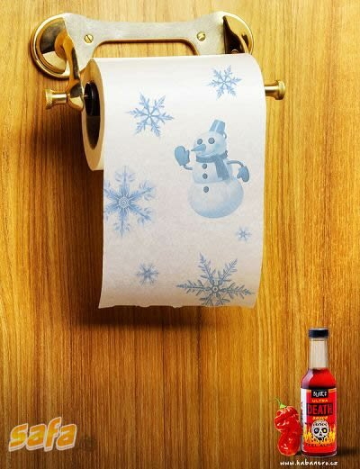

Asta e una din reclamele la care trebuie să fi avut experienţe similare anterioare, cu aripioare sau shaorme. Nu zic mai multe pe front page, te las să te prinzi singur.

Dacă tot nu te-ai prins, uită-te cu atenţie la oamenii de zăpadă de pe hârtia igienică şi apoi la sosul extrapicant pentru care e acest print. Fă exerciţiul ăsta de câteva ori. Dacă tot nu te-ai prins, bagăun meiu 5 crispy de la KFC şi aşteaptă până a doua zi. După aia uită-te din nou la print.

O să îl înţelegi perfect.
