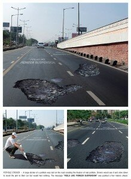

Uite tipul ăsta de reclame OOH n-ar merge cu siguranță la noi, pentru că s-ar pierde în peisajul de gropi pe care îl avem din mila mamei natura, în cârdășie cu guvernul și firmele care căpușează statul și lucrările pe care le derulează în infrastructură.

La noi, așa ceva ar stârni cel mult o sprânceană ridicată. Majoritatea șoferilor ar trece peste ele nepăsători.

via adsofhteworld

Reclama e la Pioneer, Y&R Everest, Mumbai, **India** !?
