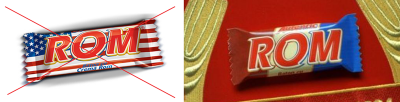
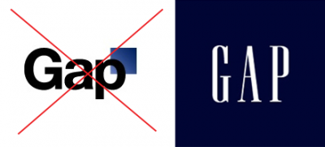

pentru că e mai mult un GAP românesc:

sesizați asemănarea 🙂

Citește mai multe despre GAP și decizia lor prin care au revenit la vechiul logo, din cauza valurilor de proteste pe Facebook și bloguri.

Și, normal, povestea ROM, prin fanii ei.
