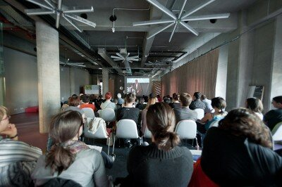
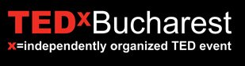

Vineri se întâmplă ceva tare de tot, vin 12+1 oameni care au avut câte cel puțin o idee extraordinară. În 18 minute, la **TEDxBucharest** , _Cătălin Ștefănescu, Raluca van Staden, Arnoud Raskin, Andrei Roșu și alții_ povestesc ideile lor care merită date mai departe, în compania a peste 500 de invitați care își doresc să se înconjoare cu spiritul TED.

Azi e ultima zi în care poți să îți mai iei bilet la TEDxBucharest 2010, care are loc **vineri, 15 Octombrie** , la Crystal Palace Ballrooms, adică aici. Biletul costă 100 dolari și este garanția unei experiențe foarte mișto, atât din punct de vedere al discursurilor, cât și al atmosferei de acolo, a potolului și a cocktailului de după eveniment. O să iasă mișto.

Și ca să demonstrăm că suntem siguri că o să se întâmple asta, anul acesta spre deosebire de anul trecut, avem live streaming.

Însă nu o facem ca toată lumea, pentru că nu e în stilul TED. Împreună cu Hostway, folosind tehnologie Microsoft, vom avea parte de **primul live stream HD din România**.

**Ce înseamnă asta?**

  * ai acces la un live-stream de calitate maximă
  * poți să schimbi camera pe care o vizionezi
  * ai acces la întreaga înregistrare în timp real
  * poți să vezi transmisia și pe Android/iPhone/iPad/Windows Phone

Cool, huh? Așa că intră pe www.tedxbucharest.com și înscrie-te, **e ultima zi**.

Dacă nu, ne vedem virtual pe **live stream**. Și pe **Facebook** , pe pagina dedicată – aici sau pe Twitter, cu ajutorul contului nostru și a hashtag-ului #tedxbucharest2010
