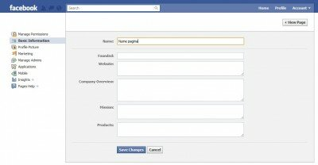

Așa cum am spus și în titlu, una din piedicile cele mai mari puse de Facebook în calea celor care își făceau pagini era numele, pe care nu puteai să îl editezi sub nicio formă. Mii de administratori de pagini s-au plâns ani de zile pe forumul pe care Facebook îl pune la dispoziție pentru comunicare și nimic nu s-a întâmplat.

Later edit: **Doar dacă pagina ta are sub 100 de like-uri poți schimba numele ei.**

Ba mai mult, majoritatea s-au dat bătuți și au acceptat faptul că paginile create cu un nume nu mai pot fi redenumite, chiar dacă brandul își schimbă identitate. Ele trebuiau abandonate.

Până azi(mă rog, ieri).  
  
Facebook și-a schimbat interfața de administrare a paginilor(vezi aici toate schimbările), ca să le facă un pic mai organizate.

Cine a administrat pagini vreodată știe cât de aglomerată și ciudată era interfața de admin, de te pierdeai prin ea. Acum au trecut la o organizare clasică – linkuri pe stânga și detaliere pe dreapta, cu aplicațiile separat de celelalte setări de targetare și limitare sau de setarea de administratori.

Surpriza cea mai mare a venit de la Basic Information, unde de acum, **poți să schimbi numele paginii de Facebook**.  

Facilitatea e încă în teste, așa că doar la unele pagini funcționează. Așteptăm să vedem dacă o să se poată face modificarea pentru absolut toate paginile.

**Atenție** – dacă i-ai ales URL personalizat paginii tale, ăla nu se mai poate schimba!
