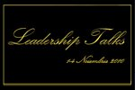

Toamna se numără evenimentele și e momentul să mergi să asculți oameni mișto aduși de companii, ONG-uri, facultăți, la care n-ai acces în mod normal. Dacă ai pierdut TEDxBucharest 2010(citește aici povestea), atunci te invit la un alt eveniment poate la fel de mișto, un pic mai vechi, cu o istorie de 3 ani deja.

Se numește Leadership Talks și e organizat a treia oară consecutiv de AIESEC București, între 1 și 3 Noiembrie, în Aula Magna a Universității Româno-Americane.

Intrarea e gratuită, dacă îți iei câteva minute și completezi formularul de pe site, până **pe 30 Octombrie** , adică duminică.

Știu, e departe, dar merită să mergi, ca să îi vezi pe următorii:

> * Andreea Esca (Jurnalist)  
>  * Alexandru Tomescu (Violinist)  
>  * Rucsandra Hurezeanu (CEO Ivatherm)  
>  * Dragoş Bucurenci (Activist ecologist)  
>    
>  * Alexandru Arsinel (Actor)  
>  * Stelă Popescu (Actor)  
>  * Dumitru Prunariu (Cosmonaut)  
>  * Răzvan Crişan (Fondatorul Asociaţiei ORICUM)  
>  * Sandra Pralong (Fondatorul Fundaţiei Synergy Communications and Synergetica)  
>  * Călin Fusu (CEO Neogen)  
>  * Ion Caramitru (Actor)  
>  * Raluca Ioana şi Jacobus van Staden (Personalităţi de ştiinţă)  
>  * Houston Spencer (Marketing Vicepresident Alcatel-Lucent)  
>  * Irina Schrotter ( Creatoare de modă)  
>  * Leslie Hawke (Presidentele Asociaţiei Ovidiu Rom)

Citește mai multe despre ei în pagina de pe site-ul evenimentului, deși majoritatea nu au nevoie de descrieri suplimentare.

Ai toate motivele să vrei să vii, așa că înscrie-te acum – aici.

Uite ce spun și ei:

> În 2010 evenimentul Leadership Talks căpăta o nouă amploare: mai mulţi speakeri, mai multe poveşti de succes,mai multe exemple şi şanse de a convinge participanţii să aibă curajul de a-si dori mai mult de la viaţă.
> 
> O atmosferă inconfundabilă, oameni cu poveşti rupte parcă din cărţi, întrebări ce îşi găsesc răspunsul si care pot ajuta tinerii să desprindă adevărate lecţii de viaţă.
> 
> Ne dorim să includem şi cea de-a treia ediţie Leadership Talks în categoria reuşitelor AIESEC Bucureşti prin atingerea obiectivelor împreună cu tinerii participanţi la eveniment.

p.s. Evenimentul se ține și în ziua de 4 Noiembrie, însă ultima zi constă într-o sesiune de traininguri de soft skills la care studenţii pot participa **numai prin implicarea la discuţii în timpul conferinţei**.
