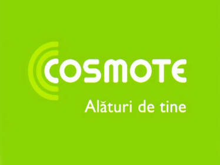

Am citit pe blogul lui Piticu despre noua reclamă de la Cosmote.

Nimic neobișnuit până aici, dacă nu te uiți la titlul articolului – Nu, nu sunt eu.

Omul vrea să se dezvinovățească de faptul că oamenii din agenția Cosmote-ului s-au folosit de imaginea lui. Nu, nu i-au cerut voie , s-a trezit cu reclama pe televizor cu un băiat care seamănă cu el.

Reclama promovează noile apeluri video către Moș Crăciun. Pe băiatul din reclamă îl cheamă Codruț și e un cocalar – narcisit. Dar nu îți zic mai multe, trebuie să vezi reclama ca să înțelegi.  

și o poză cu bloggerul nostru:

Îți dai seama cum s-a simțit Piticu, nu?
