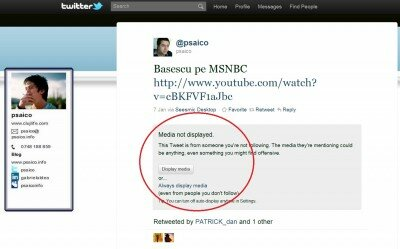

Dacă pe Twitter ai intrat cumva pe linkul direct al unui tweet care conține un video sau o fotografie, atunci, în cazul în care nu urmărești persoana respectivă, nu ți se afișează imediat conținutul media.

Treaba asta am văzut-o aici(pentru cei care nu-l urmăresc pe @psaico).

Mi se pare o funcție amuzant de inutilă, pentru că, de cele mai multe ori, folosesc Twitter printr-o aplicație terță, deci nu pot beneficia de funcția asta de apărare.
