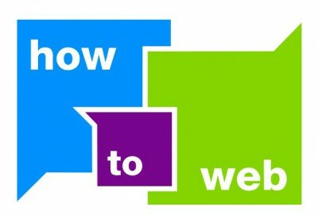

Acum o săptămână întrebam pe Twitter care sunt **conferințele de online, PR, marketing și social media din 2011 în București** , pentru că vreau să îmi fac un plan personal de învățare bazat și pe ciclul ăsta de conferințe.

În 2010 am fost la majoritatea evenimentelor importante din mediul online românesc și, pe lângă ideile care mi-au venit de acolo, m-am întâlnit cu oamenii pe care îi văd mai rar, am cunoscut oameni noi, așa că am avut, în mare parte din timp, doar de câștigat. De aceea recomand oricărui om de online, fie că face doar social media, fie că e account sau copy, fie că deja se ocupă de strategie, să participe la cel puțin jumătate din evenimentele de mai jos.

**Conferințele**

E cel mai cunoscut eveniment despre promovarea in mediul online și e destinat oamenilor de marketing si advertising. In perioada 22-23 februarie 2011, la Hotel Crowne Plaza din Bucuresti, forumul aduce in prim plan cele mai noi idei, solutii de optimizare a campaniilor online si studii de caz relevante. L-am urmărit pe Twitter anul trecut și anul ăsta vreau să merg live, la fața locului.

> Cred ca ar trebui sa discutam despre cum putem face afaceri in amandoua mediile, despre cum le putem face sa se sustina reciproc. Cred ca online-ul se vinde foarte prost cat timp are ca principal argument costurile scazute si/sau disparitia potentiala a printului.

spunea Bogdan Th. Olteanu anul trecut. Anul ăsta sper să ducem discuțiile înspre mix-uri de comunicare funcționale și managementul brandului pe internet. Am făcut live blogging de la PR Forum 2010.

Am fost blogger oficial anul trecut, din partea Nokia, așa că poți să citești live blogging-ul meu și de la Mobile Marketing Conference 2010.

> Practicieni locali recunoscuti sunt invitati sa ofere solutii concrete prin care companiile pot creste eficienta campaniilor de marketing si identifica noi oportunitati de crestere pe o piata competitiva, in care bugetele sunt tot mai restranse, iar mizele tot mai ridicate.

Nici aici n-am ajuns live anul trecut, însă am urmărit pe Twitter ce s-a discutat, plus ce a scris Sabina pe blog, de la eveniment. Anul ăsta e programat.

> Evensys organizeaza prima editie a Social Networks Conference, un eveniment dedicat marketingului si comunicarii in retelele sociale. Cred ca viitorul promovarii online va fi legat intr-o mare masura si de retelele sociale si cum Facebook este fenomenul momentului, o astfel de conferinta mi s-a parut a fi oportuna. Iata cateva motive de a participa.

Cristi a vorbit cel mai bine despre eveniment anul trecut și mi-a părut rău că n-am putut ajunge, pentru că eram în Slovenia în perioada aia, la Golden Drum 2010, ca blogger oficial. Am citit ce s-a întâmplat pe acolo pe blogul IAA Young Professionals Romania și pe blogul Oanei Maria Lungu și anul ăsta nu o voi rata.

Cu Webstock am o relație mai specială, am fost și în 2009(unde am scris) și în 2010(unde am scris din nou) și, cel mai probabil, voi merge și în 2011. E gratis, e fun, înveți multe dacă ai răbdare și filtrezi informațiile, trecând peste românescul trolling de evenimente.

Nu mi-e foarte clar ce e cu conferința asta, însă seamănă mult cu tema sub care a funcționat Webstock-ul în 2010. Oricum, subiectul e interesant și de urmărit

Social Networks Strategy e la a doua ediție în 2011. Anul trecut nu am reușit să ajung, deși am făcut parte din clipul de promovare pentru eveniment(prima mea experiență de genul ăsta). Poți să afli mai multe de pe refresh.ro, unde Costin a publicat o serie de clipuri.

Conferinta How To Web 2010 este, conform organizatorilor, cel mai important eveniment de antreprenoriat si tehnologie web din Europa de Est. Nu știu încă dacă se ține în 2011(probabil că în partea a doua a anului), dar poți citi un articol pe blogul meu despre How To Web-ul din 2010.

Și nu în ultimul rând să nu uit de RoNewMedia, conferința la care vin cei mai mulți vorbitori internaționali. Am fost la RoNewMedia 5.0, de unde am scris live pe blog în prima zi, iar detaliile despre a doua zi le-am primit printr-un guest post. Evenimentul are loc, de regulă, în Noiembrie.

Am ales și din gama BizForum conferința care mi s-a părut cea mai relevantă din punct de vedere al conținutului pentru un om de online.

> Eveniment dedicat brandurilor romanesti, proprietarilor acestora si celor care pun umarul la construirea lor. BrandRO reuneste specialisti in branding, manageri si antreprenori, profesionisti din domeniul marketingului si al publicitatii intr-un eveniment ce aniverseaza in premiera cele mai puternice 50 de branduri romanesti.

Anul trecut BrandRo a publicat câteva topuri și studii destul de interesante(Top 50 branduri românești) despre brandurile din România. Conferința nu este una de online, însă completează portofoliul de informații și cu câteva subiecte legate de branding, pe care orice om de comunicare ar trebui să le înțeleagă.

Închei selecția mea de conferințe cu propunerea de completare a listei. Dacă ai fost la o conferință mișto în 2010 sau știi de una la care orice om de online ar trebui să fie în 2011, atunci scrie-mi un comentariu.

_Nu mai vorbesc deOnline MeetUp-urile susținute de Orange, Lumea SEO/PPC sau de Open Coffee, pentru că sunt evenimente ciclice(lunar/bilunar/săptămânal), dacă ai timp, du-te măcar la 2-3 ediții. Și de acolo ai de învățat._
