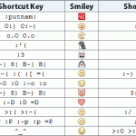
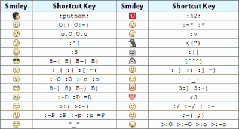

 Click pentru zoom 

_Guest post scris de Nechita Gabriel, care pe lângă ce face online, vrea să te ajute să fii motivat în fiecare zi, de aceea a creat un site numai cu Citate Motivationale noi în fiecare zi._

Facebook devine mainstream. Cu toate astea nu pun accent doar pe Facebook, Facebook-ul este doar o parte dintr-un mix. O parte foarte importantă de altfel, dar dacă ajungi să te concentrezi doar pe un canal, vei depinde prea mult de acel canal. Eu sunt de o părere fermă că trebuie să îţi diversifici sursele de trafic şi mediile prin care interacționezi cu clienţii tăi.

Dar nu despre diversificare este vorba în acest articol, în acest articol îţi voi prezenta câteva utilităţi (sau opţiuni/aplicaţii) ale Facebook-ului mai puţin cunoscute, dar care te pot ajuta în scop de marketing sau în scop personal.

**1\. Vanity URL**

Această opţiune simplă, dar de efect este foarte des ignorată de cei care fac promovare prin Facebook, în special prin intermediul paginilor de brand. Vanity URL îţi permite să setezi un url mai scurt, de forma facebook.com/username, pentru pagina ta. Eu o folosesc pentru toate paginile pe care le administrez sau le-am administrat. Ai grijă cum alegi username-ul, pentru că nu îl vei putea schimba. E permanent.

**2\. Impactul tău pe Facebook** ****

Această opţiune se referă la câţi useri ai adus tu pe Facebook. Deşi am convins foarte multe persoane să îşi facă profil pe Facebook sau să înceapă să îl folosească în scop de marketing/promovare/branding, după ce mi-am verificat Facebook Impact-ul că de fapt nu am adus din punct de vedere numeric prea mulţi useri noi Facebook-ului, doar 3 useri.

Sincer mă bucur că am făcut, sau mai bine zis că nu am făcut asta, pentru că influenţa mea vrea să fie una post-creare cont, nu pre-creare cont. Mă interesează cum folosesc oamenii Facebook-ul, nu dacă îşi fac cont de Facebook.

**3\. Friendship Page** ****

Nu-i aşa că te-ar interesa să vezi ce ai în comun tu şi cu un prieten de al tău? Probabil ai observat până acum butonul de “View friendship”. Dacă nu, ar fi cazul.

Acel buton îl văd doar ca pe ceva de fun, însă dacă eşti mai inteligent privind utilizarea lui, ai putea să te conectezi mai bine cu audienţa ta, dacă să zicem că tu îţi întreţii brand-ul personal prin intermediul unui profil de Facebook.

Pagina de prietenie se poate obţine şi prin introducerea unui link special de tipul:

> http://www.facebook.com/<id-ul tău de Facebook>?and=<id-ul prietenului tău de Facebook>

**4\. Mesaje targetate** ****

Mă refer aici pentru pagini în special. Targetarea asta se poate face pe două niveluri:

  * La nivelul mesajul directe trimise de către pagini şi care ajung în updates, acest lucru se face din secţiunea marketing/send an update din panel-ul tău de pagină de facebook
  * La nivel de wall, unde poţi să setezi cine să vadă şi cine nu, acest lucru se face înainte de a trimite un update dând clic pe iconiţa cu lacăt de lângă butonul de share şi specificând persoana care nu vrei să vadă statusul.

Recomand varianta a doua celor care vor să posteze pe Wall-ul personal mesaj de genul brainstorming: “Unde să merg în weekend cu prietena?” sau “Ce cadou ar trebui să îi fac prietenei de ziua ei?”. Numai ai grijă ca să nu strice surpriza vreuna dintre prietenele ei, ştii cum e, femeile vorbesc între ele.

Revenind la lucruri mai serioase acum. Cred că ar fi ceva deosebit şi deosebit de inteligent să abordezi targetat audienţa pe care o ai. Cu cât eşti mai specific în mesaj şi mai bine direcţionat îţi cresc şansele de a vinde ceva.

**5\. Descarcă informaţiile postate pe Facebook** ****

Nu vreau să repet ce face acest tool. Brief-ul lor este foarte bun:

This tool lets you download a copy of your information, including your photos and videos, posts on your wall, all of your messages, your friend list and other content you have shared on your profile. Within this zip file, you will have access to your data in a simple, browseable manner.

Ca şi curiozitate, se pare că toată informaţia mea postată pe facebook are 63MB. Mi se pare puţin, dar adevărul este că eu nu prea am pus poze sau video-uri. Poţi cere să primeşti informaţiile tale pe mail urmând instrucţiunile din Download your information – learn more.

**6\. Tu de când eşti pe Facebook?** ****

Ar fi fost interesant ca această informaţie să fie inclusă undeva în setările contului sau şi mai bine să o poţi bifa să apară pe profilul tău. Mi se pare o informaţie destul de utilă.

Din păcate, nu este aşa de uşor să obţii această informaţie. Ca să descoperi acea dată trebuie să te înarmezi puţină răbdare şi să apeşi pe older posts, butonul de la la sfârşitul statusurilor tale de pe wall-ului tău personal, până nu mai apare. Sunt pe Facebook din 6 aprilie 2009.

**Nota Titus:** eu sunt pe Facebook din Decembrie 2007

**7\. Agenda telefonică de pe facebook** ****

Sincer nu am auzit pe niciunul dintre cunoscuţii mei să folosească această opţiune, deşi mi se pare chiar utilă. Decât să dai un email sau să te chinui să faci rost de orice altă metodă de contact, poţi apela la acest “artificiu” şi să contactezi omul direct. Pentru a accesa agenda ta telefonică click pe Facebook Phonebook.

**8\. Smiley-uri** ****

Facebook Chat are smiley-uri. Asta nu cred că era o surpriză. Însă o surpriză pentru tine ar fi că nu ştii toate smiley-urile care se pot folosi în chat-ul de facebook. Ai imediat sub punctul acesta o imagine cu smiley-urile şi combinaţia de taste specifică.

 Click pentru zoom 

## Concluzii

Acestea sunt doar câteva dintre opţiunile Facebook care nu sunt folosite la randamentul maxim, însă tu poţi să foloseşti facebook-ul, ceva mai deştept decât îl folosesc ceilalţi.

Dacă alegi să le foloseşti poţi obţine diverse avantaje ori în scop de marketing, ori în scop personal.

**În final te întreb, tu ce opţiuni din cadrul Facebook, care nu sunt prea uzitate, cunoşti?**
