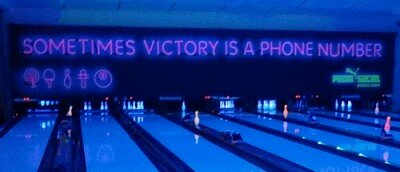
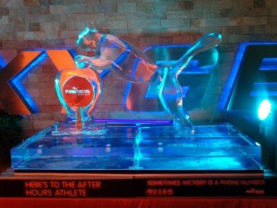
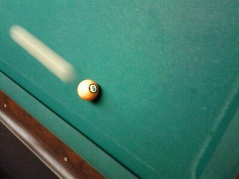
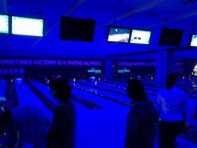

Joi a fost petrecerea **PUMA Social** , unde m-am dus echipat cu încălțările PUMA și cu niște chef de joacă – doar știam că o să ne jucăm biliard, darts, bowling și ping-pong. Ceea ce am și făcut, de altfel, pentru că nu eram tocmai megafan al trupelor cântătoare pe scenă, dar și pentru că mă pliez foarte bine pe conceptul lor de **atlet afterhours**.

M-am luptat eroic la biliard cu o fată frumoasă, mult mai talentată și mai grațioasă decât mine, am excelat la darts, însă după ce se terminase competiția oficială. La bowling, însă, am strălucit, alături de Clickio, Ariel, Minxieee, Valy și niște papuci mărimea 47(da, în **Club Oxygen** au mărimi mari pentru papucii de bowling).

M-am pus abia acum pe scris pentru că am alergat prin țară. De vineri până duminică am reușit să parcurg către **2000 de km cu mașina** , de la București la Cluj, apoi la București, la Drobeta Turnu Severin, apoi la Orșova și Eșelnița, Cazanele mici și înapoi la București. De asta am și plecat la 1 de la petrecere, deși abia atunci ajunsese și Nihasa, pe care trebuia să îl bat la ping-pong.

Din păcate, singura chestie pe care am filmat-o pe drum a fost cum **două libelule se iubeau pe un mac** , așa că nu pot să candidez la postura de membru în echipa națională a atleților AfterHours.

Dar timpul nu-i pierdut. 

Intre **12 mai si 30 iunie** , Puma premiaza atletul de rand. Nu ala care-si atarna medalii castigate la Olimpiada, ci ala care, dupa serviciu sau in weekend, mai merge la o sala, mai joaca un **darts, ping pong, bowling, fusball sau biliard**. De-astea.

Tot ce trebuie sa faci este sa te filmezi in timp ce te dai in spectacol practicand unul dintre sporturile de mai sus, inscrie filmuletul pe pagina de Facebook Puma si roaga-ti prietenii sa te voteze.

Poti castiga:

> –**produse PUMA** in valoare de 1500 de euro:  
>  –**o bicicleta PUMA**  
>  –**un card PUMA de discount 50%** , valabil un an,  
>  –**1000 de Euro cash**.  
>  –**10 truse de supravietuire** , un tricou, parfum, antiperspirant, sosete, lenjerie, pasta si periuta de dinti, o lama de ras si niste spuma, guma de mestecat, picaturi pentru roseata ochilor, o cartela telefonica de trei euro

Poze mai multe sunt pe zoso.ro, unde apar și eu, desigur, sau la Piticu(venit direct de la Desperados). Pe Facebook sunt vreo 2 albume mișto – 1, 2.

Deci să recapitulăm – **vrei produse PUMA de 1500 de euro? Filmează-te, înscrie-te și cheamă-ți prietenii să te susțină.**

Credit foto de la începutul articolului: _Clickio.ro._ Restul sunt pozele mele.
