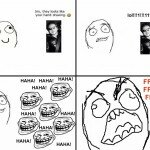

_Articol din seria constructivă despre online_

De data asta n-am chef să mai scriu un mic how to sau să dau sfaturi. Vreau să analizez un pic un subiect mai sensibil. Fiecare blogger trece și prin momente în care vede pentru a N-a oară ceva ce îl enervează sau cineva îl împinge la limită și îi sare muștarul.

Mi-am făcut o listă de **10 lucruri care mă scot din sărite** , din papucii mei de blogger. Deja sunt o grămadă de articole despre ce urăsc alții la bloggeri, subiectul e expirat.

Ia să ne uităm un pic și la noi în ogradă – **pe noi ce ne scoate din pepeni**?

  1. Cererile de link exchange – mai ales cu spamblogurile/spamsite-urile
  2. Articol copiat/idee furată, fără să mai primesc link
  3. Comunicatele de presă trimise cu BCC, ca pentru jurnaliști
  4. Oamenii insistenți – care nu se prind că, dacă nu le răspunzi la 5-10 mailuri, înseamnă că s-ar putea să nu te intereseze oferta lor
  5. Țeparii – promit campanii/proiecte, te bagi și ți-o iei(respectiv plata nu ți-o mai iei)
  6. Condescendeța de comentator/blogger/troll/hater – hai să nu ne mai purtăm ca și cum unii sunt pe piedestal, alții în plebe
  7. Oamenii care fură identitatea pe net – comenteaza aiurea în numele meu
  8. Discuțiile fără rost, în contradictoriu – dacă vrei să fii troll, ajungi în spam
  9. Postacii – ai de promovat un site, un partid, un ceva. Fă-o inteligent, semnează-te cu un nume, nu da comentarii diferite de pe același IP, sperând că te aprob
  10. Articolele fără comentarii

Pe tine ce te scoate cel mai tare din sărite?
