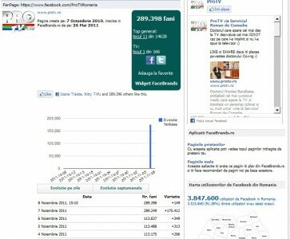

Azi am intrat pe Facebrands și am luat un pic topul la ochi, după ce am văzut o intrare surpriză în primele 20 de pagini din România. Pro Tv a reușit să strângă nici mai mult, nici mai puțin decât 175.000 de fani în ultimele 24 de ore.

Inițial m-am gândit că au ceva concurs cu superpremii, plus o campanie de Ads foarte bine făcută, însă activitatea de pe Wall/Pagină nu indică nimic din valul de creștere pe care l-au înregistrat. Unii ar putea zice că s-a produs un aflux de conturi inactive care au dat like paginii, pentru că interacțiunea a rămas la același nivel:

Dacă totuși fanii sunt reali, atunci rata de implicare a utilizatorilor în conversație e îngrijorător de mică. Oricum te-ai uita la pagină, ceva e în neregulă. Poate mă lămurește cineva, unul din experții social media din piață, ce s-a întîmplat în cazul ăsta.
