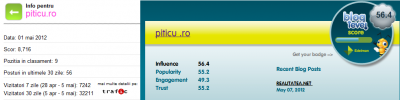
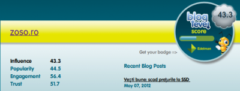
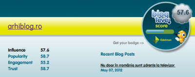

În .ro avem un singur calculator de influență pentru bloguri. Nu zic că e puțin, având în vedere că e o piață sub 1 milion de euro. Totuși, dacă aveți dubii despre un media plan pe care vi l-a împins agenția în față sau nu știți dacă un blogger e mai răsărit decât altul, atunci, pe lângă Zelist, puteți încerca la BlogLevel.

Nu zic că e 100% precis, însă dă niște cifre pe care poți să le compari cu topul nostru autohton.

Exemple:

Scorul meu:

Câțiva din zelist:

Și, bonus, Zoso și Arhi:

Citit aici.

În mod evident, nu e un sistem de referință de luat pe nemestecate, însă e o alternativă cel puțin valabilă pentru zelist-ul nostru și pentru cei care fac în mod curent campanii pe bloguri, care caută bloguri noi pe care să intre, care vor să testeze vechile bloguri sau să le compare cu cele noi.

Nu-s programator, însă dacă aș fi, aș face un mare top bazat pe mai multe instrumente de tipul ăsta.
