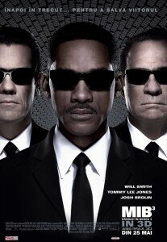

Săptămâna trecută primeam o invitație un pic mai stranie. Dincolo de faptul că eram chemați la tăierea panglicii pentru Men in Black 3 în România, la Cinema City, la IMAX, în AFI Palace Cotroceni, invitația includea și o precizare nouă: faptul că era interzis să venim cu aparate de înregistrat. Mai mult, se spunea că eram de acord cu percheziții corporale.

Chestia asta a făcut cel puțin un blogger să stea acasă și, zic eu, rău a făcut, pentru că filmul e foarte bun. Are atât efecte speciale pentru care merită să îl vezi la calitate IMAX și nu de pe torrets(cum, piratează cineva?), cât și o poveste destul de bine închegată încât să nu te prinzi de detaliul fin care leagă tot decât la finalul finalului filmului. Nu zic mai multe.

E tot film din categoria ”mergi cu fata ca să se lipească de tine la fazele mai de speriat”.

**Premiera filmului e pe 25 mai** , așa că treceți la coadă la bilete și vă zic eu că nu o să ieșiți dezamăgiți din cinematograf.

Mulțumesc _Cinema City_ , respectiv _InterComFilm_ pentru spectacol,  _Red Bull_ de energizant și  _Oxygen PR_ de invitație.

La final, trailerul:
