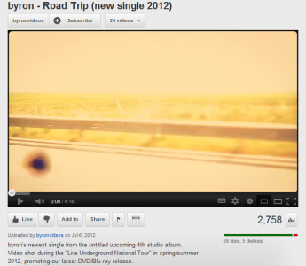

Am urmărit ieri cu interes lansarea clipului Byron exclusiv pe bloguri. Chiar inițiatorul zicea pe Twitter că peste 100 de bloguri au publicat ieri, la ora 12, clipul cu pricina, ceea ce nu e deloc de neglijat.

După mai bine de 24 de ore, am capturat numărul de vizualizări pe care le-a făcut clipul într-o zi de prezență pe blogurile mici și mijlocii.

Un calcul simplu spune că, în medie, fiecare blog a generat fix 27,58 vizualizări pentru videoclip, din care mare parte, îmi permit să estimez, au venit de pe Chinezu.eu.

Nu neg că acest gen de campanii ar putea fi relevante și utile pentru blogosfera românească, însă cred că muzica se poate lansa mai cu spor pe site-uri de muzică. Aviz și pentru alți amatori de campanii online – nu vă bazați exclusiv pe bloguri, ci integrați-le într-un mix de comunicare online, împreună cu site-uri de profil, o campanie de display și niscaiva PR.

Pe de altă parte, să atingi un pic sub 1% din numărul total de views pe care îl avea canalul tău de youtube în 24 de ore e ceva pentru trupa Byron.
