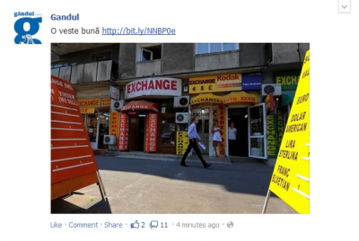
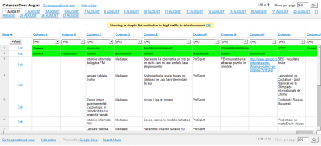

Acum câteva minute a apărut pe Facebook, din partea paginii Gândul.info, următoarea postare:

(aici, deși probabil că o vor șterge).

Linkul de bit.ly, probabil făcut în viteză, duce spre un document intern foarte util pentru oricine care vrea să vadă modul în care se organizează Mediafax Group din punct de vedere al conținutului.

Frumoasă treabă, aviz responsabililor de social media din toate companiile. Nu publicați niciun material fără să fi verificat în prealabil linkul pe care îl menționați în mesaj. Știu, e brainless, dar te scutește de bătăi de cap după aceea, prin birourile șefilor.
