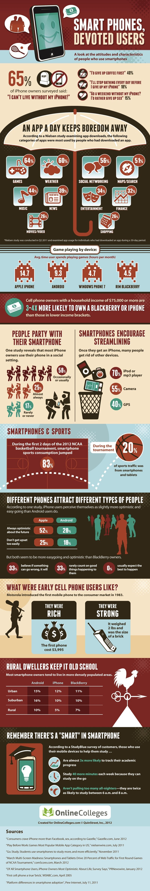

…sau 18% n-ar mai face baie, dacă asta ar fi condiția să păstreze telefonul.

Un infografic semnat de OnlineColleges.com (apropo, e un instrument de promovare foarte bun) și pe care l-am cules de pe Mashable spune că **65% din utilizatorii de iPhone chestionați nu pot trăi fără telefonul mobil** sau că **40% dintre ei ar renunța la cafea** înainte să dea din mână telefonul.

Altfel studiul cuprinde și alte date mult mai importante pentru advertiseri, spre exemplu. Oamenii cu venituri mari sunt de 3-4 ori mai înclinați să își ia un gadget decât cei mai prost plătiți, după cumpărarea unui smartphone, alte gadgeturi devin redundante (ipod, mp3 player, radio portabil etc.), dar și învață cu 40 de minute în plus în fiecare zi sau își urmăresc planul de învățare cu ajutorul telefonului.

Cu toate că în România erau doar 2.5 milioane de smartphone-uri (aprilie 2012), piața crește, iar odată cu ea, trebuie să crească și interesul advertiserilor pentru ea. Eu am folosit smartphone din 2009 și nu m-aș întoarce la vechile telefoane.

Mai jos infograficul:

