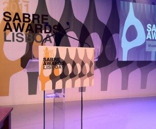

> Campania „Transparency is Gold”, semnată de The Practice, a fost realizată pentru Roşia Montană Gold Corporation şi a fost premiată la categoria Issue Management. Campania a reprezentat un demers lung şi amplu de informare a blogosferei românești cu privire la proiectul minier. Din analizele realizate cu şase luni înaintea campaniei, pe timpul și cu șase luni după campanie, au reieșit rezultate pozitive indiscutabile în ce priveşte indicatorii de comunicare. Campania a fost de altfel premiată cu aur la competiţia locală, Romanian PR Award, nominalizată la European Excellence Awards, şi premiată cu aur la EMEA SABRE Awards.

(de aici)

Da, trei premii până acum, dintre care două internaționale și unul național. Așa se fac campanii pe bloguri. Mulțumesc tuturor bloggerilor care au fost alături de noi și agenției The Practice pentru implicare și profesionalism.

**Later edit:** și apariția din IqAds.ro ne onorează.

  

(sursa foto)
