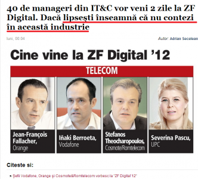

Îmi pare rău, dar cineva trebuie să le-o zică. Au dat-o de gard cu titlul ăsta:

A cui este vina că IAB Forum a fost în același timp cu ziua 1 a conferinței lor și că unii am ales să fim acolo?

Una peste alta, cred că o publicație și o echipă quality cum e cea a ZF, ar trebui să evite exprimări de genul ăsta. Dau bine doar în echipele de creație, pentru restul e posibil să fie o mică jignire.
