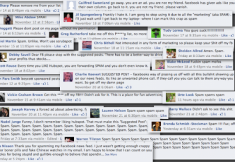

Acum ceva vreme descopeream un nou blog de agenție. Se pare că, spre deosebire de mulți alții, s-au ținut de el și dau știri interesante despre social media și o fac săptămânal.

De data asta vorbesc de spam prin Promoted posts, ROI, de inutilitatea SEO, despre faptul că Facebook a început să șteargă cover photos care nu-s conforme cu termenii și condițiile rețelei. Lucruri de citit, din punctul meu de vedere.

Mai multe aici.

