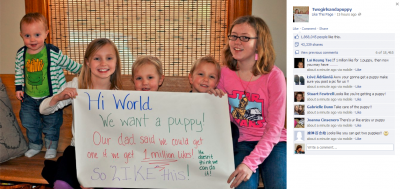

Pe vremuri, îmi puneam părinții să facă diverse chestii pentru mine, copil fiind, dacă, de exemplu, luam media 10 la matematică (din clasa a 4-a chestiunea asta n-a mai fost așa de simplă). Așa am primit primul snowboard, în liceu.

Ei, p-atunci n-aveam Facebook și 10-le la matematică era echivalentul celor 1.000.000 de like-uri pe care au crezut părinții fetelor din poza de mai jos că le pot pune în calea dorințelor lor de a adopta un câine.

Dar s-au înșelat și ambiția lor, precum și trendul de social care plutește în internetosferă, au făcut ca poza să strângă peste ~~1,8 milioane de like~~ 2,5 milioane de like-uri și încă nu s-a oprit. Cu o asemenea performanță, ar putea deveni _social media experts_ din moment în moment. Senzațional! 🙂

Altă poveste, mult mai stupidă, ce-i drept, dar similară – Megatron și milionul de likeuri.
