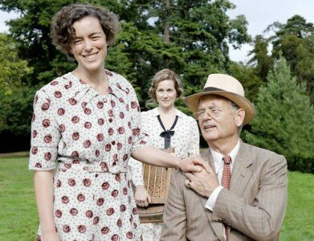

Săptămâna asta am mai fost la un film, tot la Cinema City. N-aveam cum să ratăm ocazia să îl vedem pe Bill Murray în rol de Roosevelt, într-un film piperat cu adulter, un strop de poligamie și o urmă de incest cu o verișoară de-a 5-a. Scandalos, nu?

Ei, și mai scandalos e modul în care îl prezintă pe regele împleticit al Marii Britanii, George VI, și pe nevastă-sa, veniți în vizită la colegii americani, în căutare de aliați. Germania era deja aproape și era imperios necesar să îi convingă să le apere fundurile. Dar nu despre asta e vorba în film, ci despre viața președintelui la casa de la Hyde Park on Hudson, o ironie la adresa Hyde Park-ului din Londra, precum și întreg ceremonialul de primire a fețelor încoronate din UK.

Totul culminează cu niște indieni dansând și cu regele care mușcă cu sete dintr-un hotdog (deh, nu puteau merge la Mc).

#devăzut, cu toate că nu s-a ridicat la nivelul așteptărilor create de trailer.

(sursa foto)
