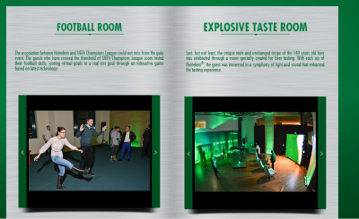

Heineken România, după un eveniment mișto de 140 de ani, împreună cu Oxygen PR, Starcom, Momentum și Webtailors, au scos un produs media mai interesant decât mailul de follow-up obișnuit.

Cred că e **primul e-book interactiv post-eveniment** pe care l-am văzut și cu siguranță e prima inițiativă de genul ăsta în toată rețeaua Heineken. Felicitări pentru asta.

Vă las cu o captură și cu linkul.

p.s. Da, recunosc, am luat bătaie în mod rușinos la fotbal. Mi-am dat seama ulterior de ce – aveam pantalonii negri și nu mă ”vedea” senzorul. Discriminare!
