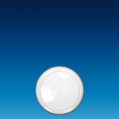
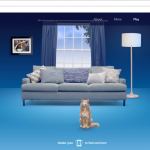
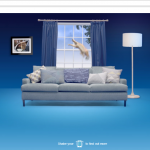

Telefonica UK a lansat o campanie foarte îndrăzneață, prin care provoacă pisicile să fie mai câini. Da, cam asta ar fi descrierea scurtă. Dincolo de povestea cu accent britanic, site-ul extraordinar de bine realizat și umorul englezesc din spate, trebuie să punctez integrarea perfectă a ecranului calculatorului cu mobilul.

Practic, jocul de Frisbee accesat prin QR code, pe mobil, e controlat printr-o aplicație care transmite trei tipuri de aruncari pisicii din ecranul calculatorului. Ea poate prinde sau nu frisbee-ul, în funcție de cum ai aruncat. M-am jucat un pic, e addictive, îți vine să îi dai share, colegii mei au apreciat și ei ideea, iar execuția nu e nici pe de parte rocket science.

Mă înclin în fața englezilor pentru campania asta. Good job, sir.

Văzută la Subiectiv, pe Facebook.

**UPDATE:**

și spotul:

Campania e făcută de MPC și VCCP.
