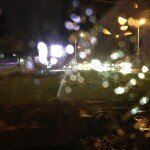

Aseară am făcut imprudența de a conduce prin piața Universității cu geamul lăsat. Era puțin mai răcoare, mergea.

Veneam liniștit dinspre Unirii, trecusem de semaforul de la ieșirea din pasaj și mă îndreptam spre rondul de la Universitate. Opresc la semafor și, după nici 2 secunde, mă trezesc stropit de țâșnitoarea de pe margine. Noroc că am apucat să închid geamul, pentru că la scurt timp a mai venit una la fel de puternică, așa că jumătate de mașină a primit un duș gratis de la instalațiile de apă pentru gazon.

Nu mai zic de faptul că jumătate din stradă era constant udată și de apa irosită.

Facem și noi ceva, domnilor primari (general, de sector, de cine o ține stropitoarea), să nu mai ajungă apa pe carosabil și pe mașini?
