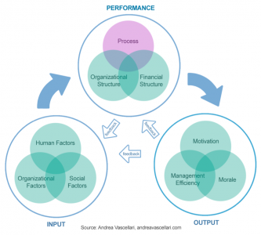
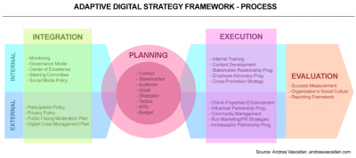

Încep săptămâna cu un set de flowcharts foarte interesante și utile pentru un om de comunicare.

Dacă nu ai încă un sistem propriu sau vrei să îl îmbunătățești pe cel pe care îl folosești în construcția strategiei de comunicare online, modelul de mai jos poate fi un bun punct de pornire, pentru că împarte procesul în două: holistic, concentrat pe resurse (prima imagine) și step-by-step, concentrat pe execuție (a doua imagine).

Ambele diagrame pot funcționa foarte bine ca un checklist.

Găsite aici, via Mirela.
