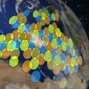

Recently, Bloomberg did an extensive piece on how Romania is now a place where IT salaries have risen five fold since 2006. While this is good for the people working there and is in line with the fact that Romania has acceded into the EU, if the trend continues, wages will become a deterrent for new ventures, conversions or expansions of IT services.

Reporters at Bloomberg said that 12,000 Romanians work for the biggest 25 technology companies in the country and Oracle is the largest employer, according to Finance Ministry data. The number is still small, if you compare it to the UK market, where just over 1 million people work in information technology related jobs.

From my point of view, it’s not the salaries that the companies should look at when switching base from, for example, UK to Romania, but at something more key to the job itself – internet connection and infrastructure costs.

A decent broadband connection in Romania can start from just under 50 Eur, while one in the UK will start giving you headaches when the bill rolls in every month. What’s more, for every pound paid you’ll get less speed than for the euro paid in Romania and there will be times where you wish your pages would just load so you can post that reply or upload that module to the SaaS your business relies on.

Event if you might run into administrative delays or issues with the state representatives, the amount of work that an internet dependent company (shouldn’t they all be dependent now?) can do within the 8 hours/day traditional time frame is significantly higher.

It’s all a matter of **infrastructure** , from where I see it, because a happy web programmer and a happy social media person share the same trait – their internet is fast.

p.s. _the longest wait when I wrote this was when I had to upload the Wikipedia image_
