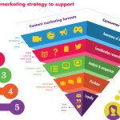

Any marketer should be able to answer this question any day, any time, anywhere. But it’s more than just **looking at the business objectives, translating them into communication objectives, setting the KPIs, choosing the strategy and the channels, planning, (testing &) implementing, monitoring and reporting, plus the evaluation** at the end of a campaign. While this straight-forward approach works for experienced marketers, I’ve found that people who have little or no practice require a bit more explaining on each point of the matter, focusing especially on strategies, tools and channels.

This is why I put together the list of tools, strategies and channel choice approaches mashed up from 4 sources that I have curated:

  1. Mashable suggests that digital teams formulate their messaging based on the brand story, the consumer sentiment and perception and trigger emotional connections with the brand. They also look at platform choice based on customer research, focusing on the places where users seek information or buy the product you are selling. Mobile and differentiation are key in this stage. Then, they focus on engagement calendars and consistency of the communication to create digital habits.
  2. Inc.com focus on testing messages, channels and strategies as you grow, on a compelling story that is share-able, on the exclusivity factor and influencer outreach.
  3. Smart Insights uses a mix of offline & online, suggesting meetups, events, a consistent content factory and participation in trade competitions (startup competitions, for example). Although these points may appear to be free or low cost, you must take into consideration the time invested in both researching and in creating quality content for each channel & relationships with the said influencers.
  4. A Forbes piece talks about naming, content and Search Engine Optimization (the PR driven one, not the “get links at all cost” one) and about integrating paid marketing in your mix.
  5. Strategy-Business.com article focuses on 4 digital marketing models, capabilities and showcases practical examples from Coca Cola, Virgin, Walmart, P&G and Henkel. From their point of view, the CMO must create the right capabilities and activate them to run successful campaigns.

An this is why I linked 3 free different templates that marketers can use to create their own digital strategy:

  1. This Smart Insights plan – more like a checklist for planning, preceded by more of the same topics I’ve covered here.
  2. The Web Strategy Planning Template – a tool which helps you translate objectives into actionable items
  3. The Digitia guide to creating your digital strategy – road-map from market to results, with examples and suggestions for each step.

If that isn’t enough, take a look at Hubspot’s 20 slide marketer mash-up for more inspiration.

_Image source_
