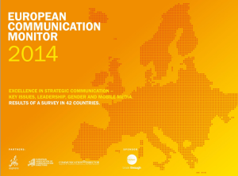

Like we needed confirmation for that.

2777 professionals in the 42 countries made this study possible. It contains key results from the largest survey on strategic communication, corporate communications, communication management and public relations worldwide.

_I went through all of the material and selected the best stuff_.

They made this cool video about the results (see below). The only thing that’s missing from it are some numbers to take away after viewing or to facilitate the no-sound play that you might experience in an open-space office or a noisy environment. Simple UX tweaking.

But back to the important stuff:

  * We’re stressed – 73% of communication professionals feel pressure is mounting on them
  * 67.6% feel the obligation to be online 24/7 and available
  * more than 80% of communications professionals do overtime, with men working more than women
  * just 36.3% think that their work life balance is alright, that’s more than 5% lower than in 2010
  * 22.5% earn less than 30,000 EUR per year, with consultancies and agencies leading the crappy salary list
  * no surprise that 78% rely on networking, 71% on education and another 71% on employer shifting to get better jobs
  * the preferred media for networking is E-mail, with 38.1% share, followed by Social Media and Face to face, with 27% and 23%
  * 45% agree that the biggest challenge is to link communications activities with business strategies
  * **86% consider digital channels to be the most relevant for strategic communications, followed closely by face-to-face**
  * but 40% do not plan to use mobile for strategic communication
  * Print media still has a 76.3% relevance in the instrument list, which is higher than TV and radio!
  * Social media gets only 63.2% relevance score and 6th place in the list, with mobile just in the 8th spot
  * companies that have an excellent communications function have a VP or Head of member of the board or reporting directly to the CEO

_Social media communications suggestions for the stakeholders:_

  * Information on events or crises that affect customers, so monitoring is key (70%)
  * CSR efforts (66%)
  * Current product and service information – so stop the non-commercial nonsense about social media posts. Of course people want to hear about your products.

_Fun facts_

  * **Aged 60+ professionals** prefer e-mail over social media (62% vs just 10%) for networking activities
  * **LinkedIn** is the undisputed leader in networking all-round (except in Russia, where it was beaten by Facebook!), with **Twitter** up next in Western Europe and **Facebook** in Eastern and Southern Europe
  * Organizational leadership is also viewed differently across the continent, with Western Europe valuing **trust** over innovation and quality and Eastern Europe valuing **quality** above all else.
  * But **trust** is the most relevant key issue in Eastern Europe, while the West focuses on **linking business and communication** strategic initiatives
  * **Romania** has the lowest satisfaction rating of all European countries, while **Norway** has the lowest ratings for people who consider internships relevant.

If you want to go trough the whole study, here’s the embedded slide deck.

Credits go to the team behind this huge research material:

> European Public Relations Education and Research Association (EUPRERA), the European Association of Communication Directors (EACD) and Communication Director Magazine, supported by Ketchum. Privacy is fully respected.
> 
> _Research Team_  
>  Ansgar Zerfass, Prof. Dr., University of Leipzig (GE) & BI Norwegian Business School (NO)- Lead Researcher  
>  Ralph Tench, Prof. Ph.D., Leeds Metropolitan University (UK)  
>  Piet Verhoeven, Dr., University of Amsterdam (NL)  
>  Dejan Vercic, Prof. Ph.D., University of Ljubljana (SI)  
>  Angeles Moreno, Prof. Ph.D., University Rey Juan Carlos, Madrid (ES)
> 
> _Advisory Board_  
>  Emanuele Invernizzi, Prof. Dr., IULM University, Milan (IT)  
>  Valerie Carayol, Prof. Dr., University of Bordeaux 3 (FR)  
>  Jesper Falkheimer, Prof. Dr., Lund University (SE)  
>  Finn Frandsen, Prof., Aarhus University (DK)  
>  Oyvind Ihlen, Prof. Dr., University of Oslo (NO)  
>  Waldemar Rydzak, Ass. Prof. Dr., Poznan University of Economics (PL)
