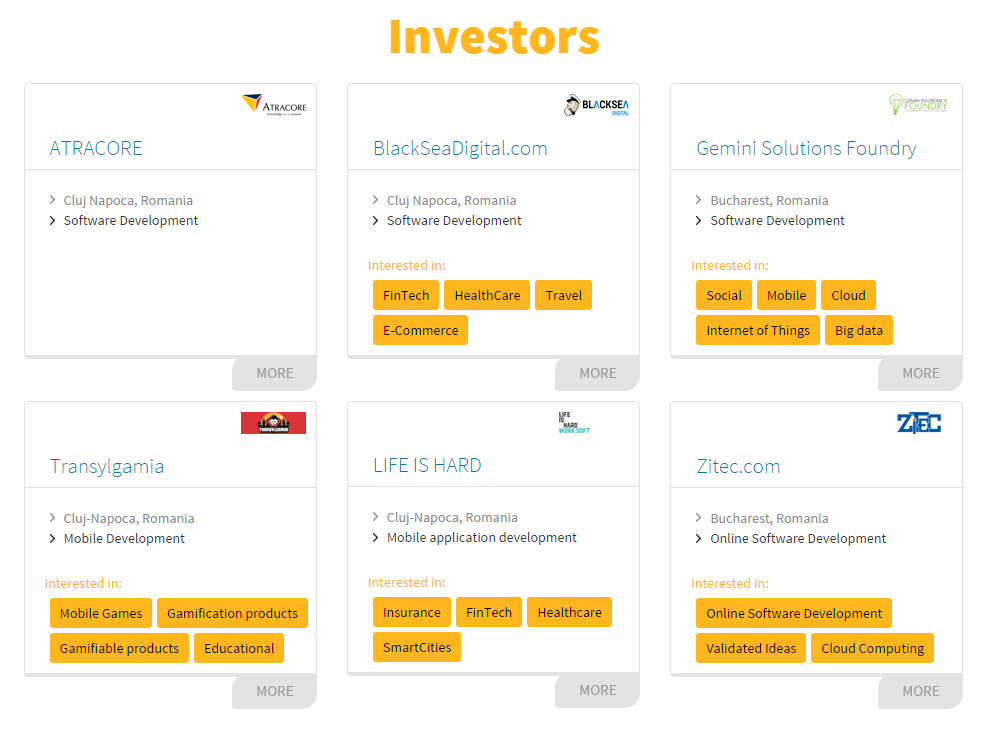

Last week I was talking to some of my Romanian friends in the UK and one of them introduced me to Startcelerate London, a pitch & match event that will take place at Level39 (great Canary Wharf co-working space) in the **October 31 – November 1st weekend**.

I said it before on my blog, Romania is one of the rising stars in tech thanks to high quality programmers, a still emerging market in terms of costs and very high Internet speeds. Thus, Romanians have decided to come to London and provide great programming and product development services to 20 eligible startups.

20 startups and up to 10 tech companies to pitch one another, get essential insights from renowned industry specialists and engage in a close matching process out of which investment partnerships can result. It’s not about money investments, but about direct investments of tech resources from strong established software companies into promising startups in exchange for equity.

**How to participate as a STARTUP?**  
A technology partner can be the essential element in developing your startup, allowing you to build or scale your technology and team. Apply here be one of the 20 selected startups for pitching in front of 10 strong tech companies and get a resource investment from one of them. If your project is selected you will have to buy a ticket for the event in order to finally confirm your presence for the event. You will receive a link with the ticket information in the confirmation email.

**Who are the sponsors (direct resource investment, remember?)**

As this was not reason enough, the organizers have prepared a list of speakers to share their knowledge and inspire the participants into building the best products ever. They are:

> **John Spindler, Enterprise Capital**  
>  John Spindler is the CEO of Capital Enterprise and Founder of Capital List. John has several years of experience with early stage businesses both as a founder, investor and an advisor. The last few years he has focused on supporting startups in the investment process and has successfully helped startups raise finance through introductions to accelerators, angels and venture capital. John is an invaluable resource for startups looking for advice in the investment process.
> 
> **Thilo Schneider, Pinset Masons**  
>  Thilo is a corporate lawyer with Pinsent Masons LLP, an international law firm specialising in the technology sector (www.pinsentmasons.com). Thilo is head of the firm’s Bootlaw (www.bootlaw.com) initiative which runs monthly events aimed at tech start-ups and his firm regularly advises emerging tech companies and their investors on corporate, IP and other legal issues.
> 
> **Jaspar Roos, Future Ideas**  
>  Jaspar is a renowned authority in the field of innovation. Jaspar has been the Chief Inspiration Officer for ABN AMRO Bank for many years. Managing the innovation and venturing lab Dialogues Incubator, Jaspar has been one of the pioneers in themes as wearable technology and crowdfunding. Currently, he is entrepreneur, writer and inspirer. His main outlets are www.futureideas.eu, www.chiefhumorofficer.com, www.ventur.es and XL Family. He loves life.
> 
> **Bill Morrow, Angel’s Den**  
>  Bill is CEO & Co-Founder of Angels Den, Europe and Asia’s largest angel network with an established equity crowdfunding platform. Since founding Angels Den in 2007, he has changed the rules on angel investing and led the way in making investment truly accessible to great businesses.Bill has run businesses in London, Hong Kong, Singapore, New York, Russia and Dubai. He is a popular keynote speaker who inspires his audiences with his open approach and determination to promote angel investing and crowdfunding and make business finance more accessible for all.
> 
> **Josh Krysiak, Citinite**  
>  Founder of Citinite, a digital marketing startup for the nightlife sector. While completing a Law degree at UCL and the University of Hong Kong, Josh gained extensive experience in the entertainment industry, from managing stages at festivals to organising, promoting and playing at events on multiple continents. Building on this expertise, he spearheaded the development of the Citinite platform in order to fill the gap in the market for a comprehensive and targeted promotion solution.

Update #1:

Two Pitch & Match events were held already in Romania, Cluj and Bucharest, both validating the event structure, the internal team efficiency and the need for this kind of alternative founding of the market. Specific to Startcelerate’s investment process is a bespoke convertible security that simplifies the negotiation, prevents premature valuation, and covers specific risks.

Update #2:

They’ve added new sponsors and partners for the event and **prolonged the application deadline until the 26th of October**.

UCL Advances(the entrepreneurial wing of UCL), Level39 (the Tech Accelerator in Canary Wharf), London & Partners (representing the Mayor of London and TechCity), Pinset Masons, Thomas Eggar LLT, F6s (the biggest network of startups and investors in the world) or DotForge (a strong accelerator specialized in tech and social).

**Last but not least, some useful links about Startcelerate:**

Video of Startcelerate concept  
Video with highlights of Bucharest event

The Pitch&Match London Event Overview presentation  
The Startcelerate Concept presentation  
The Executive Summary & Sponsorship packs presentation
