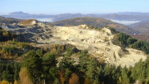

European Parliament President Martin Schultz, recently declared that Europe needs an investment package to overcome low growth and high unemployment. Of note, he said the following:

> “We need targeted investment in areas where, in the short term, it will stimulate the economy and create jobs and, in the long term, safeguard our children’s future. We need to invest in areas and projects which will generate the greatest value added.” (Source: Europa.eu website)

The Roşia Montană mining project and other similar projects across Europe, which extract natural resources with sustainability and social responsibility as core principles, together with the highest regard for environmental standards, will create jobs and welfare for local and national communities, and could contribute to fulfilling the growth objectives put forward by Mr. Schultz.

The World Gold Council reported in October that, in 2013, fifteen of its members surveyed employed over 160,000 people and had a total expenditure of $47.3 billion, out of which 79% ($37.4 billion) was spent inside the country of operation. Of that $37 billion, 88% benefited suppliers, local people and communities and only 12% went to national budgets. Imagine a European Union that is self-sustainable and prosperous thanks to its rational use of currently available resources and a sound exploration strategy.

Read more on the Rosia Montana News website.
