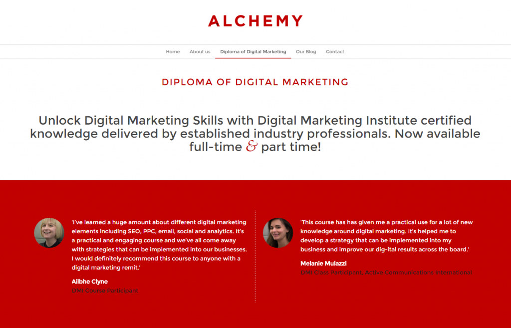

Proud again to announce something cool that I am going to do this year in London. I’m going to put my Digital Marketing, MBA and Entrepreneurship skills & experience to good use mixed with the seasoned methodologies of the Digital Marketing Institute to create the space for Londoners to take the first steps in the digital world. Here’s the blog post I wrote for the class earlier in the week. Please feel free to share 🙂 And use the  _EARLY BIRD_ code when registering.

**Update 6/3/2015:** Supersaver code expired, please use Saver 🙂

**Update: 24/3/2015:** The Saver code is gone now!

We believe in giving before taking, so here are our 10 key digital marketing tips that will help you build amazing campaigns using the best digital mix.

**1\. Be helpful, honest and open** – the rise of the internet & mobile connections have brought people closer together & closer to brands. It’s now more important than ever to stand out with a helpful message. Give before you ask.

**2.** **Write for your customers, not for Google** – too much we have focused on keywords and link-building for search engine optimization and forgot about the power of digital PR, organic mentions and fresh content.

**3\. The click is just the beginning of the journey** – use today’s wide variety of pay per click networks, but don’t forget to track your customer all the way from the banner/link ad to your thank you page. You will learn a lot.

**4\. Email is king** – if used correctly, email is still a very powerful tool, even with the rise of social media. Gets people clicking and gets people buying. What would you do without all those travel deals, Timeout offers or cool discounts that you get every day?

**5.** **Display advertising enriches brands** – pictures are worth 1000 words, especially in display advertising. Show what’s great about your product of service, make people smile, laugh or go “aha” with that design and copy. Clicking isn’t everything here.

**6.** **Use that mobile connection wisely** – our (smart)phone is the most intimate communication tool of them all. We carry it around with us every day and use it regularly. Do everyone a favour and don’t be intrusive. Connect with a purpose and add value.

**7\. Measure everything** – the internet was a big leap forward from the TV or print ads because we now can track each and every marketing tactic. So we know what works and what doesn’t and focus just on the stuff that works. Analytics tools have to be part of every digital mix, no matter how small.

**8\. Social media is about being social** – Don’t just start a social media channel to broadcast, use it to connect and engage with your customers, answer their questions, post useful content and entertain them. Oh, and use photos and videos a lot, it works.

**9\. Not all social networks are useful for your business** – or for yourself for that matter. Learn how to choose from the wide range of networks and go where you can best provide added value and reach your customers at the same time. I know, a tricky one.

**10\. The strategy pulls it all together** – the mix of tools is not a campaign unless we make strategic choices and establish a clear path, a tone of voice, narrative, approach, network mix and a set of indicators that will tell if we are successful or not. Never start a digital marketing effort without a strategy. You’ll never know if you are successful.

This is just a 5 minute taster of a 10 module Professional Diploma in Digital Marketing, an accredited course we are running this spring in London. Just to give you an idea of its scale, over 9,000 professionals from 36 countries have graduated and taken enhanced digital knowledge back to their businesses. So why not join them in April?

We have two types of classes, both full time and part time, run by two experienced tutors, Mike and myself.
