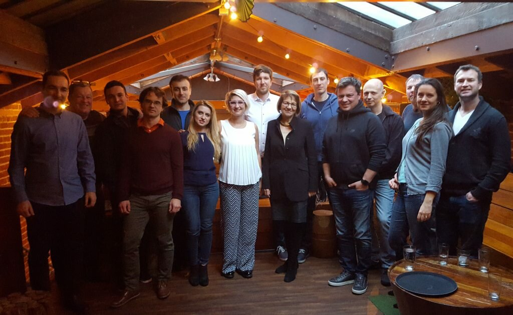

Romanians working in IT in San Francisco met for the first time on February 5 as part of the Romanian IT local chapter. This the first step in building a global Romanian IT community, part of the project “IT without borders”, which aims to facilitate communication and collaboration among Romanians everywhere. We’re now over 20 people and looking forward to welcoming even more!

For the past 15 years, many Romanians have left their home country to work in IT in the Bay Area, so it was only natural to start the Romanian IT community here. Now they have access to a platform that can connect both locally and with Romanian IT specialists world wide to work on relevant projects and initiatives. This may very well be a solution to one of the biggest problems that Romania is facing — brain drain.

Read more here
